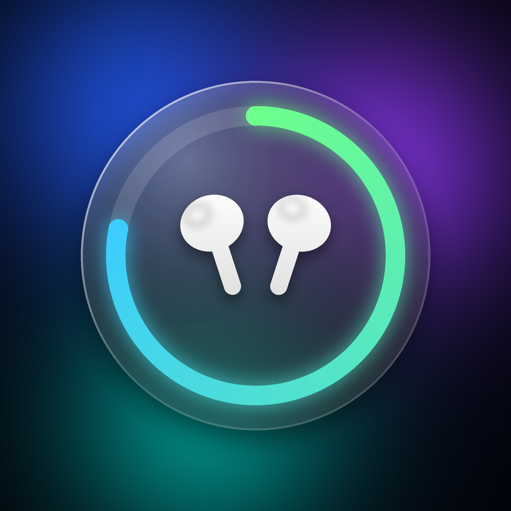

<p align="center">
  
</p>

<h1 align="center">Buds Battery</h1>

<p align="center">
  Battery levels of your Samsung Galaxy Buds on iPhone — left earbud, right earbud and charging case.<br>
  Native SwiftUI, Liquid Glass design, no account, no network, no tracking.
</p>

<p align="center">
  <a href="https://github.com/ZASAonSK/BudsBattery/actions/workflows/build.yml"></a>
  
  
</p>

> **Unofficial project.** Not affiliated with, endorsed by or sponsored by Samsung. *Samsung* and *Galaxy Buds* are trademarks of their respective owners.

## Features

- **Left, right and case battery** in large rings with live status ("Live · connected", "Last seen 5m ago").
- **Guided setup** — open the case near your phone, pick your earbuds from the list, done.
- **Trend and estimate** — whether a level is rising or falling and roughly how long it will last.
- **Battery history** chart, stored on your device.
- **Liquid Glass** interface on iOS 26+, frosted-material fallback on iOS 16–25.
- **11 languages**, following your phone's language: English, Slovak, Czech, German, Spanish, French, Italian, Polish, Portuguese, Korean, Japanese.

## How it works

iOS apps cannot open the Bluetooth Classic (RFCOMM/SPP) link that tools like [GalaxyBudsClient](https://github.com/timschneeb/GalaxyBudsClient) use on Android and desktop, so this app reads the battery from the two sources iOS does allow:

| Source | When | Notes |
| --- | --- | --- |
| **Bluetooth broadcast** | App in the foreground | Galaxy Buds advertise their battery levels. Works without pairing; may need the case to be open. |
| **GATT Battery Service** | Earbuds connected to the phone | Live updates. Takes priority over the broadcast. Case level over GATT is only mapped for the SM-R630 (Buds3 Pro). |

The layout of the broadcast frame was **inferred from captured Galaxy Buds3 Pro advertisements**; it is not a published protocol. Other models may not decode.

## Supported devices

| Device | Status |
| --- | --- |
| Galaxy Buds3 Pro (SM-R630) | Developed and tested with this model |
| Other Galaxy Buds | Unknown — may or may not work. Reports welcome |

## Install

There is no App Store build. The app is distributed as an **unsigned IPA**:

1. Download `BudsBattery-<version>-unsigned.ipa` from the latest [Release](../../releases/latest). (Every push to `main` also builds one, available as an artifact of the *Build iOS IPA* run under *Actions*.)
2. Sign and install it with your own tool (e.g. Feather, AltStore, Sideloadly) and your own Apple ID or developer certificate.

Requires **iOS 16 or later**. Bluetooth permission is requested on first launch.

## Limitations

- **No ANC control, no in-ear detection, no charging indicator.** These need the RFCOMM link that iOS keeps closed to third-party apps. The Samsung vendor GATT service on the earbuds accepted writes but did not answer, and no protocol documentation exists for it.
- **Foreground only.** Scanning stops when the app is in the background, so there is no widget or background monitoring.
- Battery values are whole percentages as reported by the earbuds. The remaining-time estimate is rough.

## Privacy

- No network requests, analytics or third-party SDKs.
- Only Samsung Galaxy Buds broadcasts are decoded; other nearby Bluetooth devices are ignored.
- The app stores, locally on your device, the identifier of the earbuds you selected, the last battery levels and the battery history. "Forget earbuds" in the menu deletes all of it.

## Build from source

Requirements: macOS with Xcode 26 (older Xcode also builds; the Liquid Glass code is compiled only with Swift 6.2+) and [XcodeGen](https://github.com/yonaskolb/XcodeGen).

```sh
xcodegen generate
xcodebuild -project BudsBattery.xcodeproj -scheme BudsBattery \
  -configuration Release -destination 'generic/platform=iOS' \
  CODE_SIGNING_ALLOWED=NO build
```

Run the decoder and history tests anywhere Swift runs (they only need Foundation):

```sh
swiftc Sources/BudsDecoder.swift Sources/History.swift Tests/main.swift -o /tmp/buds-tests && /tmp/buds-tests
```

## Project layout

| Path | Purpose |
| --- | --- |
| `Sources/BudsDecoder.swift` | Parser for the Galaxy Buds broadcast frame (pure Foundation) |
| `Sources/History.swift` | Battery history, trend and remaining-time estimate (pure Foundation) |
| `Sources/BudsStore.swift` | CoreBluetooth: scanning, GATT, merging of both sources, persistence |
| `Sources/PairingView.swift`, `ContentView.swift` | First-run setup and the battery screen |
| `Sources/Theme.swift` | Liquid Glass helpers and background |
| `Sources/Resources/*.lproj` | Translations |
| `Tests/main.swift` | Decoder and history checks |

## Translations

UI text goes through `L("English text")`; the English text is the key, so a missing translation falls back to English. To add or fix a language, edit `Sources/Resources/<lang>.lproj/Localizable.strings` (and `InfoPlist.strings` for the Bluetooth permission text). The current translations were written without native-speaker review, so corrections are very welcome.

## License

[MIT](LICENSE)

## Acknowledgements

[GalaxyBudsClient](https://github.com/timschneeb/GalaxyBudsClient) by timschneeb was used as a reference for how Galaxy Buds expose their state on other platforms. The current source contains no code from it.
